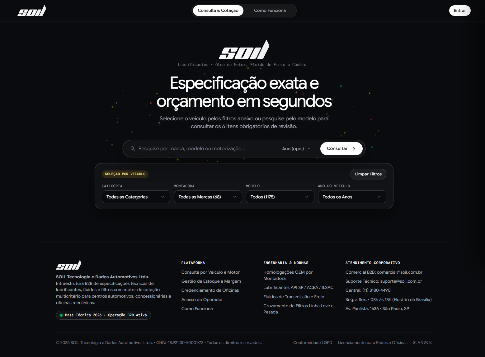
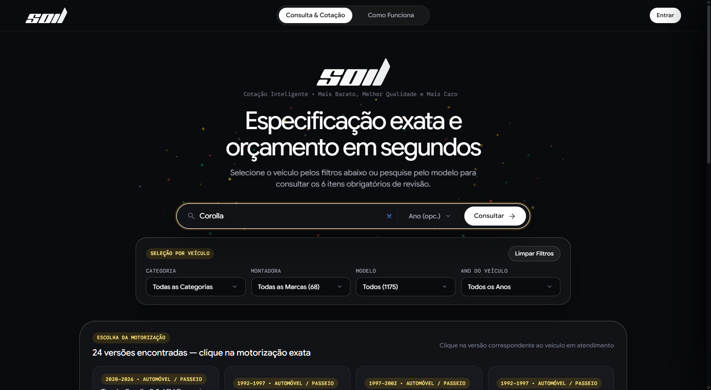
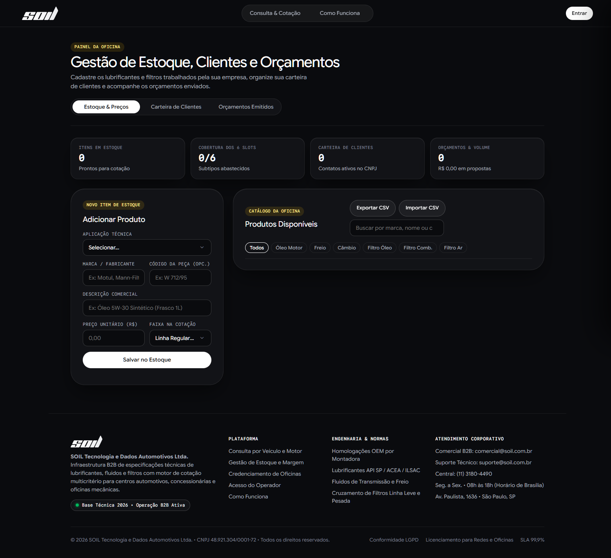
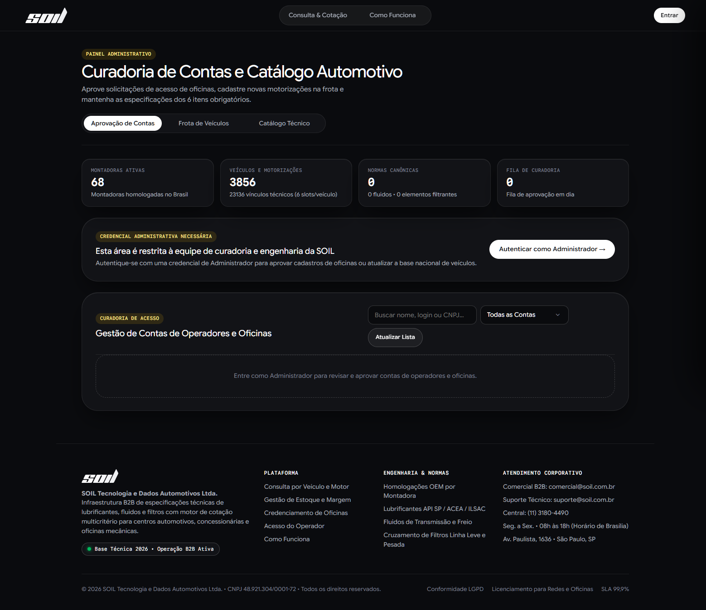

# SOIL • Plataforma B2B de Especificação Técnica Automotiva & Orçamentos

Plataforma multi-tenant construída em **TypeScript Estrito**, **Clean Architecture (Hexagonal)**, **Domain-Driven Design (DDD)** e **Test-Driven Development (TDD)** para centros automotivos consultarem os **6 itens técnicos obrigatórios** por veículo e gerarem orçamentos instantâneos em **3 faixas de preço** (`Mais Barato`, `Melhor Qualidade`, `Mais Caro`) com envio por e-mail.

## Documentação e Histórico Salvos no Projeto

- **Documentação Técnica e Funcional Completa:** [docs/DOCUMENTACAO_COMPLETA_SOIL.md](./docs/DOCUMENTACAO_COMPLETA_SOIL.md)
- **Plano Diretor de Engenharia e TDD:** [docs/plans/2026-10-24-soil-master-plan.md](./docs/plans/2026-10-24-soil-master-plan.md)
- **Arquitetura de Alto e Baixo Nível:** [docs/arquitetura/soil_arquitetura_e_requisitos.md](./docs/arquitetura/soil_arquitetura_e_requisitos.md)
- **Contrato OpenAPI 3.1.0:** [docs/api/openapi.yaml](./docs/api/openapi.yaml)
- **Migrations, Pipeline ETL TecDoc e Seeds SQL (MySQL 8.0+):**
  - [infra/database/migrations/001_initial_schema.sql](./infra/database/migrations/001_initial_schema.sql)
  - [infra/database/seeds/002_seed_brazilian_fleet.sql](./infra/database/seeds/002_seed_brazilian_fleet.sql)
  - [infra/database/seeds/003_seed_tecdoc_national_fleet.sql](./infra/database/seeds/003_seed_tecdoc_national_fleet.sql) (65 montadoras, 3.851 veículos no SQL + 5 veículos demo = 3.856 veículos totais, 93 catálogos canônicos, 23.106 especificações técnicas e 279 produtos homologados)
  - [scripts/sanitize-tecdoc.py](./scripts/sanitize-tecdoc.py) e [scripts/curated_fleet_data.py](./scripts/curated_fleet_data.py) (Pipeline ETL de sanitização das 231 planilhas TecDoc, remoção de elétricos puros/placeholders e curadoria da frota popular brasileira nas 4 categorias: `CARRO`, `UTILITARIO`, `CAMINHAO` e `MOTO`)
  - [apps/api/src/infra/database/tecdoc-sanitized.json](./apps/api/src/infra/database/tecdoc-sanitized.json)
- **Infraestrutura Docker de Produção & CI:**
  - [Dockerfile](./Dockerfile) (Imagem Node.js 20 Alpine com validação de tipagem estrita e healthcheck)
  - [docker-compose.yml](./docker-compose.yml) (Orquestração completa: MySQL 8.0 com migrations/seeds automáticos, API SOIL e Mailpit SMTP/UI)
  - [.env.example](./.env.example) (Modelo de variáveis de ambiente para produção)
  - [.github/workflows/ci.yml](./.github/workflows/ci.yml) (Pipeline GitHub Actions validando `npm run typecheck` e `npm test` em Node.js 20)
- **Histórico Integral da Conversação e Relatórios de Arquitetura:**
  - [docs/conversacao/HISTORICO_CONVERSACAO_SOIL.md](./docs/conversacao/HISTORICO_CONVERSACAO_SOIL.md)
  - [docs/conversacao/RELATORIOS_SUBAGENTES_ARQUITETURA.md](./docs/conversacao/RELATORIOS_SUBAGENTES_ARQUITETURA.md)
  - [docs/conversacao/transcript_full.jsonl](./docs/conversacao/transcript_full.jsonl)

## Comandos Rápidos

```powershell
# Validar compilação TypeScript estrita (zero erros)
npm run typecheck

# Rodar os 40 testes automatizados da suíte TDD (Vitest)
npm test

# Reprocessar a base TecDoc e regenerar o JSON + SQL de produção
python scripts/sanitize-tecdoc.py

# Iniciar o servidor web + API REST em http://localhost:3000 (modo rápido em memória)
npm run dev:demo

# Subir ambiente completo containerizado (MySQL 8.0 + API SOIL + Mailpit SMTP em http://localhost:8025)
docker compose up --build -d
```

## Registros Visuais da Aplicação

### Consulta Técnica e Orçamentos (`/index`)


### Especificações Técnicas e Desambiguação de Veículos


### Painel Operacional da Oficina Credenciada (`/oficina`)


### Painel Administrativo e Gestão da Frota Nacional (`/admin`)


## Rotas do Portal Corporativo B2B (`logo-soil.svg`)

- `http://localhost:3000/index` : Omnibox de busca com seletor de ano, filtros em cascata com busca embutida (65 montadoras / 3.856 veículos nas 4 categorias `CARRO`, `UTILITARIO`, `CAMINHAO` e `MOTO`), desambiguação de motorização, grade dos 6 itens técnicos obrigatórios com pílulas padronizadas e gaveta lateral de cotação em 3 faixas com fechamento opcional em frascos de 1L + cálculo de sobra técnica, impressão/PDF, cópia de resumo comercial, WhatsApp e disparo por e-mail.
- `http://localhost:3000/auth` e `http://localhost:3000/principal` : Portal de Acesso e Credenciamento B2B de Oficinas (validação de CNPJ pelo Módulo 11 e solicitação de acesso de operadores).
- `http://localhost:3000/oficina` : Painel de indicadores operacionais (KPIs de estoque, cobertura dos 6 subtipos, clientes e receita de cotações), gestão de estoque multi-tenant com pílulas rápidas por subtipo (`Todos`, `Óleo Motor`, `Freio`, `Câmbio`, `Filtro Óleo`, `Filtro Comb.`, `Filtro Ar`), edição direta de preço/código (`PATCH /api/products/:id`), exportação/importação CSV em lote (`POST /api/products/batch`), carteira de clientes com atalho de 1 clique para o último veículo cotado (`Cotar <Modelo> →`) e histórico de cotações emitidas.
- `http://localhost:3000/admin` : Painel de indicadores globais (65 montadoras ativas, 3.856 veículos homologados, 93 normas canônicas e fila de curadoria), aprovação de contas pendentes, gestão da frota nacional e catálogo técnico base com busca embutida nos seletores.
- `http://localhost:3000/help` : Guia operacional de atendimento, regras de formação das 3 faixas de orçamento e arquitetura multi-tenant por CNPJ.

## Próximos Passos Salvos (Roadmap)

1. **Deploy Containerizado em Produção (`MySQL 8.0` + `API` + `SMTP`):** Subir o ambiente `docker compose up --build -d` (ou publicar na VPS `engine.lat` / Cloud Run) com `USE_IN_MEMORY_DB=false`, aplicando automaticamente a migration `001_initial_schema.sql` e o seed relacional `003_seed_tecdoc_national_fleet.sql`.
2. **Consulta por Placa (Mercosul e Antiga) na Omnibox (`/index`):** Resolver placa digitada na barra de busca para identificar instantaneamente marca, modelo, versão e ano do veículo.
3. **Inclusão de Mão de Obra e Desconto Comercial no Orçamento (`#quote-drawer`):** Permitir adicionar serviços de mão de obra (troca de óleo, sangria de freio, troca de fluido de câmbio) e desconto comercial na gaveta lateral, PDF e WhatsApp.
4. **Alerta de Revisão Preventiva na Carteira de Clientes (`/oficina`):** Indicar clientes cuja última troca completou 6 meses / 10.000 km com disparo de lembrete via WhatsApp em 1 clique.
