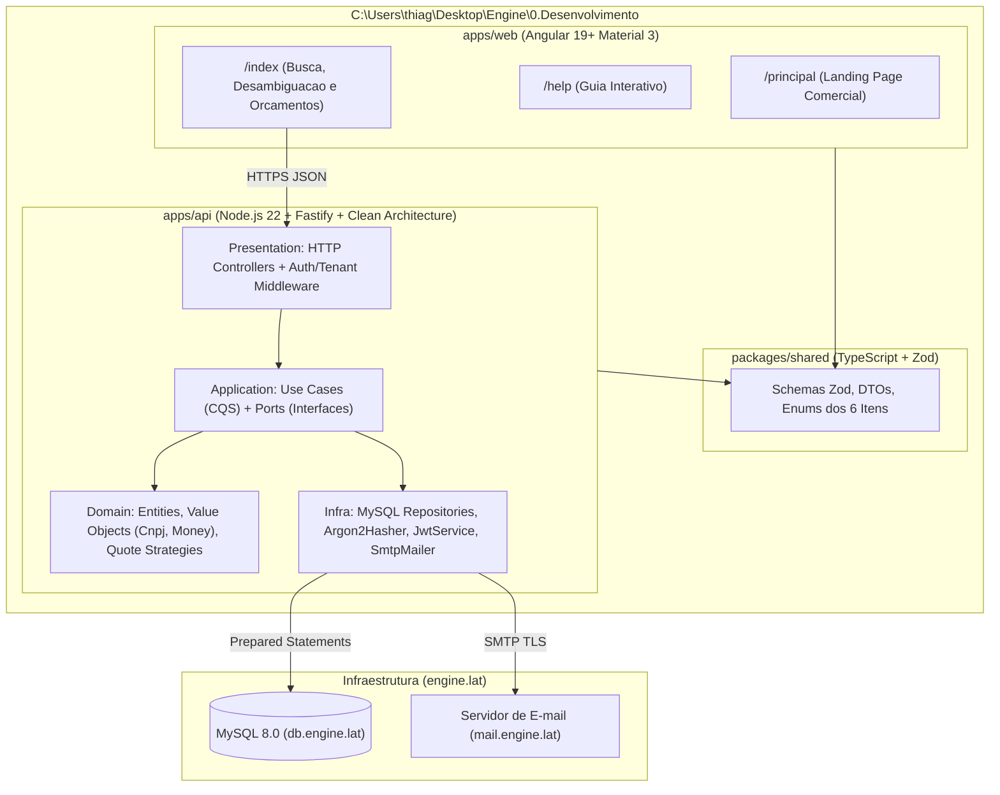

# Plano Diretor de Engenharia, Arquitetura (Alto e Baixo Nível) e Execução TDD: Soil

**Objetivo:** Construir o sistema **Soil** do zero em `C:\Users\thiag\Desktop\Engine\0.Desenvolvimento`, como uma plataforma SaaS B2B multi-tenant para oficinas e centros automotivos consultarem especificações técnicas de lubrificantes e filtros e gerarem/enviarem orçamentos inteligentes por e-mail, guiada por Clean Architecture, DDD Tático, Clean Code e Test-Driven Development (TDD).

**Arquitetura:** Monorepo Full-Stack em TypeScript Estrito (`apps/api`, `apps/web`, `packages/shared`, `infra/database`) aplicando **Arquitetura Hexagonal / Clean Architecture** no backend (Domínio puro isolado de frameworks, Casos de Uso orientados a portas/interfaces e adaptadores MySQL 8.0 + Fastify) e **Angular 19+ (Signals + Material Design 3)** no frontend.

**Stack Tecnológica:**
- **Linguagem:** TypeScript 5.8+ (`strict: true`, `noUncheckedIndexedAccess: true`, `exactOptionalPropertyTypes: true`)
- **Backend:** Node.js 22 LTS, Fastify 5, Zod (validação e contratos), `mysql2/promise` (Prepared Statements nativos), Argon2id (hashing de senhas), JOSE/JWT (autenticação stateless + refresh token), Nodemailer (`mail.engine.lat`)
- **Banco de Dados:** MySQL 8.0 (`utf8mb4_0900_ai_ci`, InnoDB, Covering Indexes `B+Tree` e `FULLTEXT`)
- **Frontend:** Angular 19+ (Standalone Components, Signals), Angular Material 3, Tailwind CSS
- **Motor de Testes (Pirâmide TDD):** Vitest (Unitários e Integração), Supertest / `fastify.inject` (Contratos HTTP) e Playwright (E2E)

---

## 1. Fundamentação Teórica das Decisões de Engenharia

### 1.1. Como aplicar o TDD corretamente: Todos os testes antes ou Ciclo por Funcionalidade?
Uma dúvida comum ao iniciar um projeto em TDD é se devemos escrever centenas de testes de todas as telas e rotas de uma só vez antes de escrever a primeira linha de código. Na literatura clássica de Engenharia de Software, fazer todos os testes do sistema inteiro de uma só vez antes de qualquer código é um antipadrão conhecido como *Test-First Waterfall* (ou *Big Test Up Front*), pois congela interfaces que ainda não foram exercitadas e gera retrabalho em cascata.

A abordagem cientificamente validada combina duas referências:
1. **As Três Leis do TDD (Robert C. Martin, *Clean Code*, 2008; Kent Beck, *Test-Driven Development: By Example*, 2002):**
   - **1ª Lei:** Você não pode escrever código de produção até ter escrito um teste que falhe.
   - **2ª Lei:** Você não deve escrever mais de um teste unitário do que o suficiente para demonstrar uma falha (não compilar já é falhar).
   - **3ª Lei:** Você não deve escrever mais código de produção do que o estritamente necessário para fazer o teste passar.
2. **Double-Loop TDD / Outside-In (Steve Freeman & Nat Pryce, *Growing Object-Oriented Software, Guided by Tests - GOOS*, 2009):**
   - Trabalhamos por **fatias verticais (Requisito por Requisito)**.
   - Para iniciar uma funcionalidade (ex.: `RF01 - Cadastro de Empresa`), escrevemos primeiro a suíte de testes de unidade daquela regra (caminho feliz, validações de borda e bloqueios de erro mapeados do antigo roteiro de testes).
   - Executamos o ciclo **RED (falha) → GREEN (implementação mínima) → REFACTOR (limpeza e aplicação de padrões)** dentro das camadas de Domínio → Caso de Uso → Repositório → Controller HTTP.
   - Só quando 100% dos testes de `RF01` estão verdes e refatorados, abrimos os testes de `RF02`. Assim o software nasce 100% coberto por testes desde o minuto zero, sem código morto e sem acoplamento frágil.

### 1.2. Por que eliminar a antiga regra de "Acesso apenas via Stored Procedures"?
Com a propriedade intelectual 100% sob seu controle, podemos corrigir o maior gargalo técnico do esboço anterior. Segundo **Martin Fowler** (*Patterns of Enterprise Application Architecture*, 2002) e **Robert C. Martin** (*Clean Architecture*, 2017):
- Stored Procedures espalham regras de negócio dentro do servidor de banco de dados, violam o **Princípio da Responsabilidade Única (SRP)**, impedem o uso de testes unitários rápidos em memória e dificultam o controle de versão e migrações contínuas.
- Em seu lugar, aplicaremos o **Repository Pattern** com **Prepared Statements parametrizados** no Node.js. O MySQL 8.0 cuidará das invariantes relacionais (`FOREIGN KEY`, `UNIQUE`, `CHECK` constraints) e da busca indexada (`B+Tree` e `FULLTEXT`), enquanto toda a regra de negócio viverá na camada de Domínio e Aplicação em TypeScript, testável em milissegundos.

### 1.3. Por que TypeScript Estrito em Monorepo?
Baseado na teoria de sistemas de tipos (**Benjamin C. Pierce**, *Types and Programming Languages*), usar TypeScript com verificação estrita no Backend e no Frontend garante que o contrato de dados validado na borda HTTP pelo **Zod** seja exatamente o mesmo tipo consumido pelos componentes do Angular e persistido pelos repositórios SQL, eliminando erros de desserialização em produção.

---

## 2. Consolidação Definitiva dos Requisitos (RF e RNF)

### 2.1. Requisitos Funcionais (RF)
| ID | Módulo | Especificação Funcional e Invariantes de Domínio |
|---|---|---|
| **RF01** | **Gestão de Empresas (Tenant PJ)** | Cadastrar empresa com Nome Fantasia (`tradeName`) e CNPJ (`cnpj`). O CNPJ deve ser higienizado (apenas dígitos), conter 14 números, passar no cálculo matemático dos **2 dígitos verificadores oficiais (Módulo 11)** da Receita Federal e ser único no sistema. |
| **RF02** | **Gestão de Usuários por CNPJ** | Cadastrar operadores vinculados a uma empresa existente (`companyId`), exigindo Nome, Telefone válido, E-mail único, Login único e Senha forte (mínimo 8 caracteres, com letra maiúscula, minúscula, número e símbolo). Uma mesma empresa (CNPJ) pode ter múltiplos usuários cadastrados. |
| **RF03** | **Autenticação, Verificação e Curadoria Admin** | Login via Login/E-mail + Senha (`Argon2id`) emitindo JWT (`sub`, `companyId`, `role`, `status`) + Refresh Token. Fluxo de verificação de e-mail por token (`SHA-256` com expiração), recuperação de senha e aprovação/rejeição de contas novas por administradores (`role = 'ADMIN'`). |
| **RF04** | **Catálogo de Veículos (Admin)** | CRUD exclusivo para `ADMIN` cadastrar veículos contendo Fabricante (`manufacturer`), Modelo (`model`), Versão/Motorização (`version`, ex.: `1.0 12V Turbo Flex`), Tipo (`CARRO`, `MOTO`, `CAMINHAO`, `UTILITARIO`) e intervalo válido de anos (`1900 <= manufYearStart <= manufYearEnd <= 2100`). |
| **RF05** | **Catálogo Técnico dos 6 Itens Obrigatórios (Admin)** | CRUD exclusivo para `ADMIN` cadastrar especificações técnicas com invariante estrita de categoria e subtipo cobrindo os **6 itens obrigatórios**:<br>• **Lubrificantes (`OLEO`):** `MOTOR`, `FREIO`, `CAMBIO`<br>• **Filtros (`FILTRO`):** `OLEO`, `COMBUSTIVEL`, `AR`<br>Vinculação N:N com veículos (`TechnicalSpecification`) informando volume em litros (`capacityLiters`), intervalo de troca (`intervalKm`) e observações técnicas (`notes`). |
| **RF06** | **Estoque e Preços por Empresa (Multi-Tenant)** | Operadores aprovados gerenciam os produtos comercializados pela sua oficina (`companyId` extraído exclusivamente do token JWT, prevenindo IDOR). Cada produto aponta para um `catalogId` e define fabricante da peça (`manufacturer`), nome comercial (`name`), código SKU/Part Number (`sku`), preço em centavos (`priceCents > 0`) e flag de destaque de qualidade (`isBestQuality`). Isolamento absoluto entre CNPJs. |
| **RF07** | **Carteira de Clientes por Empresa (Multi-Tenant)** | Operadores cadastram, listam, editam e removem clientes (`name`, `phone`, `email`) vinculados ao `companyId` da sua oficina. O mesmo e-mail ou telefone não pode ser duplicado dentro do mesmo CNPJ, mas pode existir de forma independente no cadastro de outro CNPJ. |
| **RF08** | **Busca com Desambiguação e Consulta Técnica (`/lookup`)** | Busca textual e por filtros (Fabricante, Modelo, Ano). Se mais de um veículo corresponder aos termos informados, retorna a lista de **desambiguação** (exibindo versão/motor e faixa de anos) para seleção exata. Selecionado o veículo único, retorna os **6 itens técnicos obrigatórios** acompanhados de litragem, notas e produtos compatíveis disponíveis no CNPJ logado. |
| **RF09** | **Motor de Orçamentos (3 Faixas + Edição Interativa)** | A partir do veículo selecionado e do `companyId` logado, gera automaticamente **3 perfis de orçamento** para os 6 itens técnicos:<br>1. **Mais Barato (`CHEAPEST`):** seleciona o produto disponível de menor preço para cada especificação.<br>2. **Mais Caro (`MOST_EXPENSIVE`):** seleciona o produto disponível de maior preço para cada especificação.<br>3. **Melhor Qualidade (`BEST_QUALITY`):** prioriza os produtos marcados com `isBestQuality = true` na categoria.<br>Permite manipulação livre antes do fechamento: adicionar/remover itens, alterar quantidades, sobrescrever preço unitário e vincular/trocar o cliente destinatário (`clientId`), recalculando o total sem erros de ponto flutuante. |
| **RF10** | **Disparo de Orçamento por E-mail** | Renderiza o orçamento finalizado em template HTML limpo e profissional (com dados da oficina, veículo, tabela de itens, valores e total) e envia para o e-mail do cliente via SMTP (`mail.engine.lat`), registrando `status = 'SENT'` e `sentAt`. |
| **RF11** | **Portal Web em 3 Rotas (`/principal`, `/help`, `/index`)** | `/principal`: Landing Page de apresentação do produto e cadastro de empresas.<br>`/help`: Central de treinamento rápido e documentação de uso.<br>`/index` (ou `/app`): Aplicação operacional de busca, desambiguação, gestão de clientes/produtos e envio de orçamentos. |

### 2.2. Requisitos Não Funcionais (RNF)
- **RNF01 — Desempenho e Baixa Latência:** Tempo de resposta da API `< 50ms` (p95) nas consultas de veículos e especificações (`/lookup`), suportado por Covering Indexes no MySQL e cache LRU em memória invalidado por eventos de escrita.
- **RNF02 — Isolamento Multi-Tenant e Segurança (OWASP API Security Top 10):** Nenhuma rota de escrita aceita `companyId` ou `userId` vindo do corpo da requisição; toda identificação de tenant vem do token JWT assinado. Senhas com hash `Argon2id`, validação estrita de payload via Zod (`422 Unprocessable Entity`), CORS restrito, Helmet headers e Rate Limiting em rotas públicas.
- **RNF03 — Precisão Monetária e Volumétrica:** Valores financeiros representados internamente como inteiros em centavos (`priceCents: number`, Value Object `Money`) e persistidos como `DECIMAL(10,2)`, eliminando imprecisões binárias de ponto flutuante (`IEEE 754`).
- **RNF04 — Testabilidade e Confiabilidade:** Cobertura de testes automatizados `>= 90%` nas camadas de Domínio e Aplicação, com testes unitários rodando em `< 2s` sem dependência de rede ou banco externo.
- **RNF05 — Usabilidade Mobile de Oficina:** Interface responsiva seguindo Google Material Design 3, áreas de toque mínimas de `48x48dp`, contraste alto para leitura sob luz forte ou em galpão e operação fluida no celular ou desktop.

---

## 3. Arquitetura de Alto e Baixo Nível

### 3.1. Arquitetura de Alto Nível (C4 Container & Hexagonal)



### 3.2. Arquitetura de Baixo Nível (Padrões de Projeto e Estrutura de Pastas)

Pautado em **Clean Architecture (Robert C. Martin)**, **Domain-Driven Design (Eric Evans)** e **Design Patterns (GoF - Gamma et al.)**, o código em `C:\Users\thiag\Desktop\Engine\0.Desenvolvimento` seguirá esta organização física e teórica:

```text
C:\Users\thiag\Desktop\Engine\0.Desenvolvimento\
├── package.json                     # Workspace root (npm workspaces)
├── tsconfig.base.json               # Configuração TypeScript estrita compartilhada
├── docs/
│   ├── adr/                         # Architecture Decision Records
│   ├── api/openapi.yaml             # Contrato OpenAPI 3.1 completo
│   └── plans/                       # Planos de implementação e checklists TDD
├── infra/
│   └── database/
│       ├── migrations/              # Scripts DDL versionados (001_schema.sql)
│       └── seeds/                   # Dados iniciais dos 6 itens e frota base
├── packages/
│   └── shared/                      # Contratos Zod e tipos compartilhados Front/Back
│       └── src/
│           ├── enums/               # CatalogCategory, CatalogSubtype, QuoteProfile
│           └── schemas/             # Schemas Zod de request/response
├── apps/
│   ├── api/                         # Backend Clean Architecture
│   │   ├── src/
│   │   │   ├── domain/              # CAMADA 1: Regras de negócio puras (zero libs externas)
│   │   │   │   ├── errors/          # DomainError, DuplicateError, ValidationError
│   │   │   │   ├── value-objects/   # Cnpj.ts, Email.ts, Phone.ts, Password.ts, Money.ts, YearRange.ts
│   │   │   │   ├── entities/        # Company.ts, User.ts, Vehicle.ts, CatalogItem.ts, Product.ts, Client.ts, Quote.ts
│   │   │   │   └── services/        # QuoteGeneratorService.ts (Strategy Pattern para as 3 opções)
│   │   │   ├── application/         # CAMADA 2: Casos de Uso e Contratos de Saída (Ports)
│   │   │   │   ├── ports/           # ICompanyRepository, IUserRepository, IVehicleRepository, IMailer...
│   │   │   │   └── use-cases/       # RegisterCompany, RegisterUser, DisambiguateVehicle, LookupVehicleSpecs, GenerateQuoteOptions, CustomizeQuote, SendQuoteEmail...
│   │   │   ├── infra/               # CAMADA 3: Adaptadores Técnicos
│   │   │   │   ├── database/        # Pool MySQL + Repositórios SQL parametrizados + Repositórios In-Memory (para testes)
│   │   │   │   ├── security/        # Argon2PasswordHasher.ts, JwtTokenService.ts
│   │   │   │   └── mail/            # NodemailerSmtpService.ts + Templates HTML de orçamento
│   │   │   └── presentation/        # CAMADA 4: Entrada HTTP (Fastify)
│   │   │       ├── middlewares/     # authGuard, tenantGuard, adminGuard, errorHandler
│   │   │       └── routes/          # Rotas REST agrupadas por contexto
│   │   └── tests/                   # Suíte TDD espelhada (unit/, integration/, e2e/)
│   └── web/                         # Frontend Angular 19+ (Material 3)
│       └── src/app/
│           ├── core/                # AuthInterceptor, TenantState (Signals), ApiService
│           ├── features/
│           │   ├── landing/         # Rota /principal
│           │   ├── help/            # Rota /help
│           │   ├── lookup/          # Rota /index (Busca, Modal de Desambiguação, 6 Cards Técnicos)
│           │   ├── quotes/          # Comparador das 3 faixas, editor de itens e disparo por e-mail
│           │   ├── management/      # Gestão de Produtos e Clientes da Oficina
│           │   └── admin/           # Curadoria de Contas e Cadastro de Veículos/Catálogo
```

### 3.3. Padrões de Projeto (GoF, DDD e P of EAA) Empregados no Baixo Nível
1. **Value Object Pattern (DDD - Eric Evans):** `Cnpj`, `Email`, `Phone`, `Money` e `YearRange` são objetos imutáveis com construtores privados e métodos de fábrica (`Cnpj.create(raw)`). Um `Cnpj` inválido jamais entra na memória do sistema.
2. **Result / Either Pattern (Programação Funcional Pragmática):** Em vez de usar `throw` indiscriminado para erros esperados de domínio, métodos críticos retornam resultados tipados ou erros de domínio previsíveis capturados por um único Error Handler global.
3. **Strategy Pattern (GoF):** O cálculo das 3 opções de orçamento (`CHEAPEST`, `MOST_EXPENSIVE`, `BEST_QUALITY`) implementa a interface `IQuoteSelectionStrategy`, permitindo testar cada algoritmo de seleção de peças isoladamente e adicionar novas regras no futuro sem violar o **Princípio Aberto/Fechado (OCP)**.
4. **Repository Pattern + In-Memory Fake Pattern (Martin Fowler):** Cada repositório possui duas implementações que passam exatamente na mesma suíte de testes de contrato (`InMemoryProductRepository` para testes unitários instantâneos e `MysqlProductRepository` para produção e testes de integração).
5. **Aggregate Root (DDD):** A classe `Quote` controla a adição, remoção e edição de objetos `QuoteItem`, garantindo a invariante de que `totalAmount` é sempre a soma exata de `quantity * unitPrice` de seus itens.

---

## 4. Plano de Implementação Passo a Passo Guiado por TDD

Cada fase abaixo segue rigorosamente o ciclo **RED (escrever o teste que falha) → GREEN (implementar o código mínimo) → REFACTOR (limpar e validar)** dentro de `C:\Users\thiag\Desktop\Engine\0.Desenvolvimento`.

### Fase 1: Fundação do Monorepo, Ferramental Estrito e Contratos Compartilhados
- **Tarefa 1.1:** Inicializar o monorepo em `C:\Users\thiag\Desktop\Engine\0.Desenvolvimento` com `package.json` (workspaces `packages/shared`, `apps/api`, `apps/web`), `tsconfig.base.json` (modo ultra-estrito), Vitest e ESLint/Prettier.
- **Tarefa 1.2 (TDD Ciclo 1 - Value Objects de Domínio):**
  - **RED:** Criar `apps/api/tests/unit/domain/value-objects.spec.ts` testando:
    - `Cnpj`: rejeitar letras, menos/mais de 14 dígitos, sequências repetidas (`00000000000000`) e dígitos verificadores inválidos; aceitar CNPJ válido com ou sem máscara.
    - `Password`: rejeitar menos de 8 caracteres, ausência de maiúscula, minúscula, número ou símbolo.
    - `Money`: somar, multiplicar por quantidade fracionária (ex.: `4.5` litros) e rejeitar valores `<= 0`.
    - `YearRange`: rejeitar `start > end` ou anos fora de `1900..2100`.
  - **GREEN:** Implementar `Cnpj.ts`, `Email.ts`, `Phone.ts`, `Password.ts`, `Money.ts` e `YearRange.ts` em `apps/api/src/domain/value-objects/`.
  - **REFACTOR:** Extrair constantes e mensagens de erro padronizadas.

### Fase 2: Domínio Central — Empresas, Usuários, Clientes e Segurança Multi-Tenant (`RF01`, `RF02`, `RF03`, `RF07`)
- **Tarefa 2.1 (TDD Ciclo 2 - Cadastro de Empresa e Múltiplos Usuários por CNPJ):**
  - **RED:** Criar `apps/api/tests/unit/application/company-and-user.spec.ts` cobrindo todos os cenários de negócio:
    - Cadastrar empresa com CNPJ inédito (sucesso) e bloquear CNPJ duplicado (`409 Conflict`).
    - Permitir empresas distintas com o mesmo Nome Fantasia desde que tenham CNPJs diferentes.
    - Permitir múltiplos usuários (funcionários) vinculados ao mesmo CNPJ com e-mails e logins distintos.
    - Bloquear usuário com e-mail ou login duplicado, ou vinculado a CNPJ inexistente.
  - **GREEN:** Implementar as entidades `Company` e `User`, as interfaces `ICompanyRepository` e `IUserRepository`, os repositórios em memória e os casos de uso `RegisterCompanyUseCase` e `RegisterUserUseCase`.
- **Tarefa 2.2 (TDD Ciclo 3 - Autenticação, Verificação de E-mail e Aprovação Admin):**
  - **RED:** Criar `apps/api/tests/unit/application/auth-and-approval.spec.ts` testando login, bloqueio de operações para conta `PENDING` ou `REJECTED`, verificação de token de e-mail e aprovação pelo `ADMIN`.
  - **GREEN:** Implementar `AuthenticateUserUseCase`, `VerifyEmailUseCase`, `ApproveUserUseCase`, `RejectUserUseCase`, `Argon2PasswordHasher` e `JwtTokenService`.
- **Tarefa 2.3 (TDD Ciclo 4 - Carteira de Clientes Isolada por CNPJ):**
  - **RED:** Criar `apps/api/tests/unit/application/client-management.spec.ts` testando:
    - Cadastro de cliente (`name`, `phone`, `email`) vinculado ao `companyId`.
    - Bloqueio de cliente duplicado no mesmo CNPJ.
    - Permissão de cadastro do mesmo cliente (mesmo e-mail/telefone) em outro CNPJ distinto.
    - Exclusão de cliente afetando apenas o CNPJ solicitante.
  - **GREEN:** Implementar a entidade `Client`, `IClientRepository` e os casos de uso `CreateClientUseCase`, `ListCompanyClientsUseCase` e `DeleteClientUseCase`.

### Fase 3: Domínio Automotivo — Veículos, 6 Itens do Catálogo, Desambiguação e Produtos (`RF04`, `RF05`, `RF06`, `RF08`)
- **Tarefa 3.1 (TDD Ciclo 5 - Veículos, Catálogo dos 6 Itens e Restrição de Admin):**
  - **RED:** Criar `apps/api/tests/unit/application/vehicle-and-catalog.spec.ts` testando:
    - Bloqueio (`403 Forbidden`) quando usuário comum (`role = 'USER'`) tenta criar ou excluir veículos ou itens de catálogo.
    - Validação estrita dos **6 tipos obrigatórios** (`OLEO: MOTOR | FREIO | CAMBIO` e `FILTRO: OLEO | COMBUSTIVEL | AR`), rejeitando combinações inválidas (ex.: `OLEO` de `AR`).
    - Vinculação de especificação técnica (`TechnicalSpecification`) com litragem (`capacityLiters`) e notas.
  - **GREEN:** Implementar `Vehicle`, `CatalogItem`, `TechnicalSpecification` e seus casos de uso administrativos.
- **Tarefa 3.2 (TDD Ciclo 6 - Produtos por Empresa e Busca com Desambiguação):**
  - **RED:** Criar `apps/api/tests/unit/application/lookup-and-products.spec.ts` testando:
    - Cadastro de produto vinculado ao `companyId` e `catalogId`, rejeitando preço `<= 0` e impedindo que uma empresa exclua produto de outra.
    - Busca aproximada de veículo (`SearchVehiclesForDisambiguationUseCase`): quando `"Gol"` ou `"Onix"` retornar mais de uma versão/ano, indicar `requiresDisambiguation: true` com a lista de candidatos.
    - Consulta técnica final (`LookupVehicleSpecsUseCase`): dado o `vehicleId` exato e o `companyId`, retornar os 6 itens técnicos do veículo + apenas os produtos disponíveis daquela empresa.
  - **GREEN:** Implementar `Product`, `CreateProductUseCase`, `DeleteProductUseCase`, `SearchVehiclesForDisambiguationUseCase` e `LookupVehicleSpecsUseCase`.

### Fase 4: Motor de Orçamentos (3 Opções + Edição) e Disparo por E-mail (`RF09`, `RF10`)
- **Tarefa 4.1 (TDD Ciclo 7 - Geração das 3 Opções e Edição Interativa do Orçamento):**
  - **RED:** Criar `apps/api/tests/unit/application/quote-engine.spec.ts` testando:
    - Geração automática das 3 faixas (`CHEAPEST`, `MOST_EXPENSIVE`, `BEST_QUALITY`) para um veículo usando os produtos cadastrados pela empresa.
    - Adição manual de item extra, remoção de item, edição de preço unitário e troca de `clientId`, verificando o recálculo exato de `totalAmount`.
    - Envio do orçamento por e-mail (`SendQuoteEmailUseCase`) garantindo que o cliente pertence à empresa, que o template HTML contém os itens e preços corretos e que o status muda para `SENT`.
  - **GREEN:** Implementar o agregado `Quote`, o `QuoteGeneratorService` (com as 3 Strategies), `CreateOrUpdateQuoteUseCase` e `SendQuoteEmailUseCase`.

### Fase 5: Persistência MySQL 8.0, Rotas HTTP Fastify e Contrato OpenAPI 3.1
- **Tarefa 5.1:** Criar o script de migração `infra/database/migrations/001_initial_schema.sql` e `002_seed_demo_data.sql` (com frota brasileira real e os 6 itens técnicos por veículo).
- **Tarefa 5.2 (TDD Ciclo 8 - Testes de Integração HTTP e MySQL):**
  - **RED:** Criar a suíte `apps/api/tests/integration/http-routes.spec.ts` testando os endpoints reais do Fastify (`/auth/*`, `/companies/*`, `/clients/*`, `/vehicles/*`, `/catalogs/*`, `/products/*`, `/lookup`, `/quotes/*`).
  - **GREEN:** Implementar os repositórios MySQL (`apps/api/src/infra/database/mysql/`) e as rotas Fastify com middlewares de autenticação JWT, validação Zod e tratamento de erros.
  - Atualizar `docs/api/openapi.yaml` para refletir 100% das rotas implementadas.

### Fase 6: Frontend Angular 19+ (Material Design 3) e Testes E2E (`RF11`)
- **Tarefa 6.1:** Estruturar `apps/web` em Angular 19+ com tema Material Design 3 (modo claro de alto contraste para pátio e modo escuro para oficina).
- **Tarefa 6.2:** Implementar as três rotas principais exigidas pelo escopo:
  - `/principal`: Landing page institucional com apresentação comercial e fluxo de cadastro de CNPJ/Usuário.
  - `/help`: Guia visual interativo de uso do sistema.
  - `/index`: Aplicação principal com Omnibox de busca, Modal de Desambiguação de Veículo, Painel dos 6 Cards Técnicos (3 Óleos + 3 Filtros), Comparador em 1 clique das 3 Opções de Orçamento (Mais Barato, Melhor Qualidade, Mais Caro), Editor rápido de orçamento e envio por e-mail.
- **Tarefa 6.3:** Executar bateria de testes E2E com Playwright validando o fluxo completo ponta a ponta.

### Fase 7 (Concluída): Precisão OEM no Teste Cego Multimarcas, Frota Popular nas 4 Categorias e Padronização Visual Mobile/Desktop
- **Tarefa 7.1 (Correção Global de Falsos Positivos no Pipeline ETL TecDoc):**
  - Expurgar veículos 100% elétricos (BEVs) e cadastros incompletos (`Motor Padrão`) em `scripts/sanitize-tecdoc.py`.
  - Implementar prioridade estrita de norma OEM por fabricante (`OEM_BRAND_KEYWORDS`) para motor e transmissão (`choose_oil_spec`, `choose_trans_spec`), herança de filtros por família de motor (`brand + model_prefix + liters_bucket + fuel`) e **93 especificações canônicas** (incluindo 51 catálogos granulares de filtros e normas específicas para Diesel pesado e Motos).
  - Injetar dinamicamente em `seedDemoData.ts` os Part Numbers reais extraídos das notas do TecDoc (`MANN-FILTER`, `MAHLE`, `WEGA`, `BOSCH`) nas 3 faixas de orçamento (`CHEAPEST`, `BEST_QUALITY`, `MOST_EXPENSIVE`).
- **Tarefa 7.2 (Expansão da Frota Popular Brasileira nas 4 Categorias):**
  - Criar `scripts/curated_fleet_data.py` e integrar ao pipeline para totalizar **3.856 veículos homologados** distribuídos nas 4 categorias (`CARRO`: 3.412, `UTILITARIO`: 371, `CAMINHAO`: 42, `MOTO`: 31) e gerar o seed relacional completo `infra/database/seeds/003_seed_tecdoc_national_fleet.sql` (8.3 MB).
- **Tarefa 7.3 (Melhorias Operacionais de UX e Cálculo de Sobra Técnica):**
  - Adicionar pílulas de filtro por subtipo no estoque (`#prod-subtype-pills`) e busca embutida dentro de `.custom-select-menu` para listas com mais de 10 opções.
  - Exibir na gaveta de cotação, no PDF e no WhatsApp o detalhamento de volume do cárter vs. frascos de 1L (`Sobra técnica`) e o botão `#btn-toggle-bottle-rounding` (`Fechar Frascos 1L` / `Usar Litragem Exata`).
  - Adicionar atalho `Cotar <Modelo> →` (`quoteClientLastVehicle`) na Carteira de Clientes (`/oficina`).
- **Tarefa 7.4 (Padronização Visual Global de Pílulas, Badges e Botões):**
  - Padronizar `.badge-slot`, `.badge-capacity`, `.tag-best`, `.spec-norm-copy-hint` e `.btn` em `apps/web/public/styles.css` e `apps/web/public/app.js` com `white-space: nowrap`, `inline-flex` e cabeçalho `.spec-card-header` dedicado, eliminando quebras de linha em todas as resoluções (`360px`, `390px`, `768px` e `1280px`).

### Fase 8 (Próximos Passos Salvos / Roadmap Planejado)
- **Passo 8.1 — Deploy em Produção na VPS (`engine.lat`) com HTTPS e MySQL 8.0 Real:**
  - Subir containers via `docker compose up --build -d`, aplicar `001_initial_schema.sql` e importar `003_seed_tecdoc_national_fleet.sql` (3.851 veículos da frota nacional, 93 catálogos, 23.106 especificações e 279 produtos base), configurando proxy reverso TLS/HTTPS e SMTP (`mail.engine.lat`).
- **Passo 8.2 — Consulta Rápida por Placa (Mercosul / Antiga) na Omnibox (`/index`):**
  - Detectar placas brasileiras (`ABC1D23` / `ABC-1234`) diretamente na Omnibox para resolver marca, modelo, ano e motorização sem exigir seleção manual nos dropdowns.
- **Passo 8.3 — Controle de Saldo de Estoque e Baixa Automática por Orçamento (`/oficina`):**
  - Adicionar `stockQuantity` e alerta de estoque mínimo aos produtos da oficina, realizando baixa/reserva automática quando o orçamento for finalizado ou enviado.
- **Passo 8.4 — Histórico de Revisão por Placa / Quilometragem (Hodômetro) e Alerta de Próxima Troca:**
  - Vincular placa e hodômetro ao orçamento (`Quote`) e calcular a previsão da próxima troca de óleo/filtros para disparo ativo de lembrete via WhatsApp e e-mail na Carteira de Clientes.
- **Passo 8.5 — Dashboard Financeiro e Curva ABC de Produtos (`/oficina`):**
  - Implementar indicadores de conversão de orçamentos, ticket médio por categoria de veículo e ranking de giro de lubrificantes e filtros.
